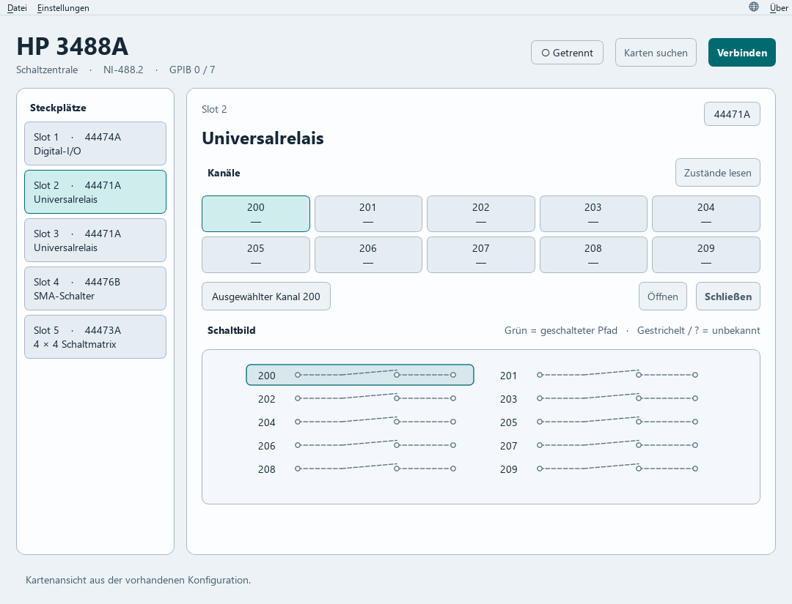
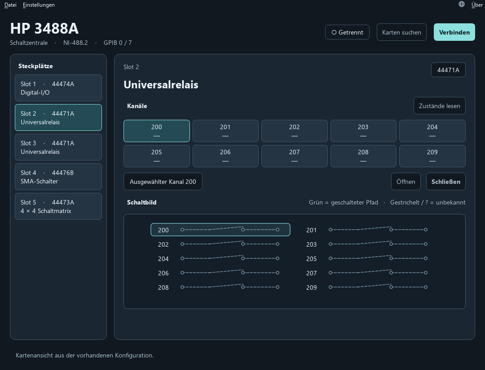

# HP 3488A Control

Windows-Anwendung für die HP 3488A Schaltzentrale. Sie erkennt die eingesetzten Karten, liest Kanalzustände und steuert Relais, Multiplexer, Schaltmatrix und Digital-I/O je nach Kartentyp.

## Bildschirmaufnahmen

| Hell | Dunkel |
| --- | --- |
|  |  |

## Installation und Verbindung

Das [GitHub-Release](https://github.com/GitterRalf/hp3488a/releases/latest) enthält das Windows-x64-Setup mit den benötigten Qt- und MinGW-Laufzeitdateien. Der Standardordner ist `C:\Programme\HP 3488A Control`. Für den Download ist ein GitHub-Konto mit Zugriff auf das private Repository erforderlich.

Für die GPIB-Verbindung den 64-Bit-Treiber NI-488.2 separat installieren. Unter **Einstellungen → GPIB-Verbindung** lassen sich Bus und Geräteadresse ändern. Voreingestellt sind Bus **0** und Adresse **7**.

## Bedienung

- **Verbinden** liest die Kartenkennungen. Die fünf Steckplätze lassen sich in der Übersicht auswählen. Die Detailansicht zeigt je nach Karte Kanäle, Schaltbild oder Digitalports.
- Unter **Einstellungen → Darstellung** stehen Hell und Dunkel zur Wahl. Das Sprachsymbol bietet Deutsch, English und Français. Die Anwendung merkt sich Fensterposition und -größe.
- Unter **Über → Nach Updates suchen** lässt sich das GitHub-Release manuell prüfen. Für das private Repository muss die GitHub CLI mit einem berechtigten Konto angemeldet sein (`gh auth login`).

## Bauen

Benötigt werden ein 64-Bit-Windows-Kit mit Qt 6 einschließlich Widgets, Concurrent, Network und Linguist Tools, CMake ab 3.24 und Ninja.

~~~powershell
.\build.ps1
~~~

Das Skript baut `build\HP3488A.exe` und stellt die Laufzeit-DLLs bereit. Anschließend `HP3488A.iss` mit Inno Setup kompilieren. Es übernimmt die Version aus `CMakeLists.txt` und das Icon aus `app.rc`. Die Setupdatei liegt im Ordner `installer`.

## Lizenz

Der Quellcode und das animierte OsciViewer-Logo stehen unter der [MIT-Lizenz](LICENSE). Die Lizenzen für Qt und MinGW stehen in den [Drittanbieter-Hinweisen](THIRD-PARTY-NOTICES.txt).
